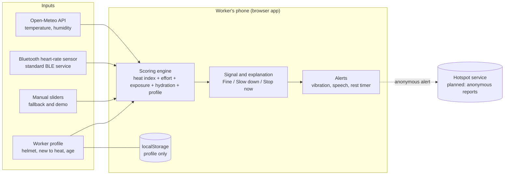

# HeatShield technical documentation

## 1. Overview

HeatShield is a personal heat-strain early warning for outdoor workers. It combines the heat around a worker with how hard they are working and shows one signal: **Fine**, **Slow down** or **Stop now**. All scoring runs on the worker's own device.

## 2. System architecture

**Data flow:** inputs are read, the scoring engine produces a 0-100 score and the three biggest contributors, the UI maps the score to a signal, and a Stop now triggers vibration, a spoken warning, a rest timer and an anonymous hotspot dot.

## 3. Tech stack

| Layer | Used in this prototype | Planned |
|---|---|---|
| App | HTML, CSS, JavaScript (single file, no build step) | Flutter for Android and iOS |
| Scoring | Rule-based formula in JavaScript | Python and TensorFlow Lite model |
| Sensing | Manual input, Bluetooth heart-rate devices | ESP32 clip with BME280 and MAX30102 |
| Weather | Open-Meteo API | Same |
| Backend | None (hotspot dots are local) | Supabase |
| Dashboard | SVG map in the app | React and Leaflet |
| Hosting | GitHub Pages | Same |

## 4. APIs and integrations

| Integration | Purpose | Notes |
|---|---|---|
| Open-Meteo `/v1/forecast?current=temperature_2m,relative_humidity_2m` | Live air temperature and humidity for the worker's location | Free, no API key. Only rounded coordinates are sent. Falls back to manual values if blocked or offline. |
| Browser Geolocation API | Location for the weather call | Asked only when the worker taps "Use live weather". Not stored. |
| Web Bluetooth, standard Heart Rate service (`heart_rate`, `heart_rate_measurement`) | Live heart rate from any compatible band, watch or ESP32 | Needs Chrome on Android or desktop. Not supported in iOS Safari. |
| Vibration API and Speech Synthesis API | Stop now alert | Vibration works on phones only. |
| localStorage | Saves the worker profile | Stays on the device. |

## 5. Scoring model

Score = environment (0-45) + effort (0-25) + exposure (0-15) + hydration (0-15) + profile modifiers, capped at 100.

| Component | Rule |
|---|---|
| Environment | Heat index (Rothfusz regression) from temperature and humidity, scaled from 27 °C to 46 °C |
| Effort | Heart rate scaled from 90 to 170 bpm |
| Exposure | Hours in the sun, scaled up to 8 hours |
| Hydration | Water drunk compared with about 0.5 L per hour in the sun |
| Profile | +4 helmet or heavy clothing, +6 new to heat work, +4 age 45 or older |

Signal thresholds: below 35 is Fine, 35 to 59 is Slow down, 60 or more is Stop now.

**Explainability:** the app shows the three largest contributors, so a worker sees why a warning appeared.

## 6. Privacy and safety design

- Scoring happens on the device. No account is needed.
- No health data is sent anywhere. Only rounded coordinates go to Open-Meteo, and only when requested.
- Hotspot reports (planned backend) contain no identity and no exact position.
- The thresholds and weights are a first version for demonstration and have not been clinically validated. HeatShield does not replace medical advice or emergency services.

## 7. Limitations

- Heart-rate sensing needs a paired Bluetooth device. The ESP32 clip is not built yet.
- The scoring is rule-based. The TensorFlow Lite model is not trained yet.
- Shade and water finding, SOS delivery and the shared hotspot backend are not implemented.
- Hotspot dots are stored in the browser only.

## 8. Future scope

1. Train a model on open heat-stress data and compare it with the rule-based baseline.
2. Build the ESP32 sensor clip and calibrate it against a reference thermometer.
3. Add a Flutter app with background monitoring and offline mode.
4. Connect Supabase and a Leaflet dashboard for city-level hotspots.
5. Nearby shade and water points from OpenStreetMap.
6. Real SOS messages to an emergency contact.
7. Pilot with delivery riders and tune thresholds from their feedback.

## 9. Run it

Open `index.html` in a browser, or serve it with `python3 -m http.server 8000`. A live copy is hosted on GitHub Pages. Live weather and Bluetooth need HTTPS, which GitHub Pages provides.
